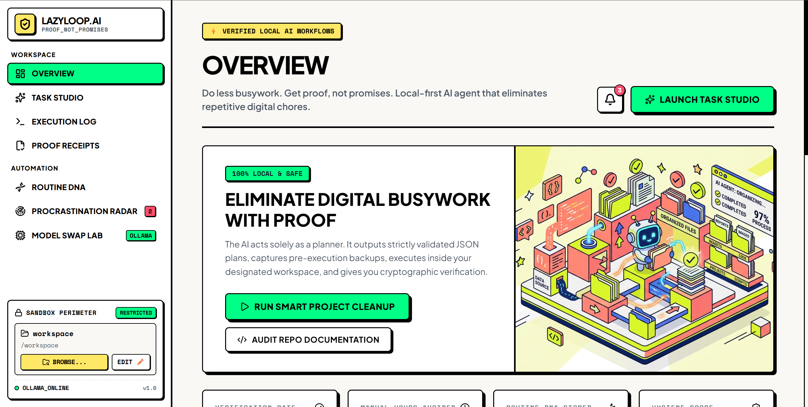
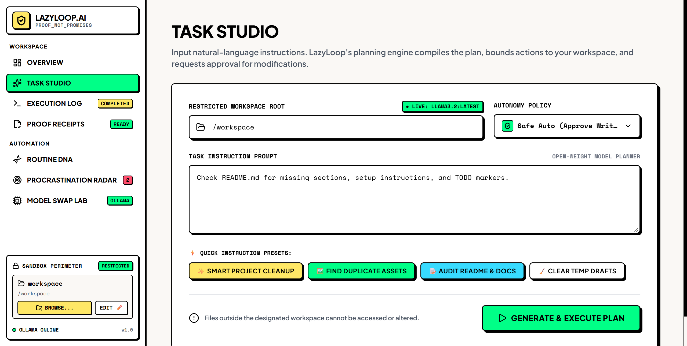
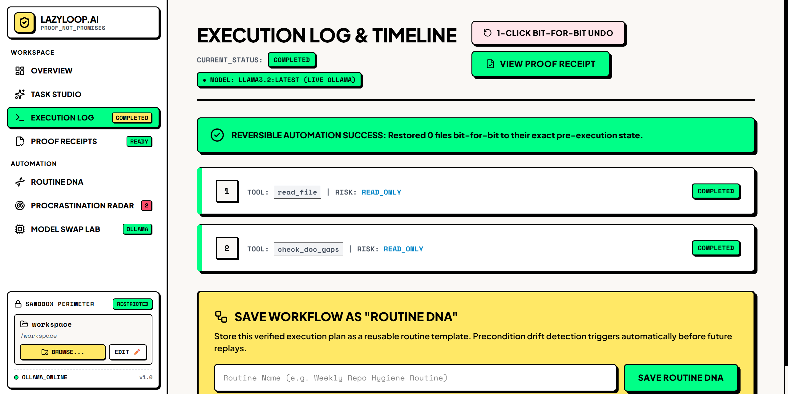
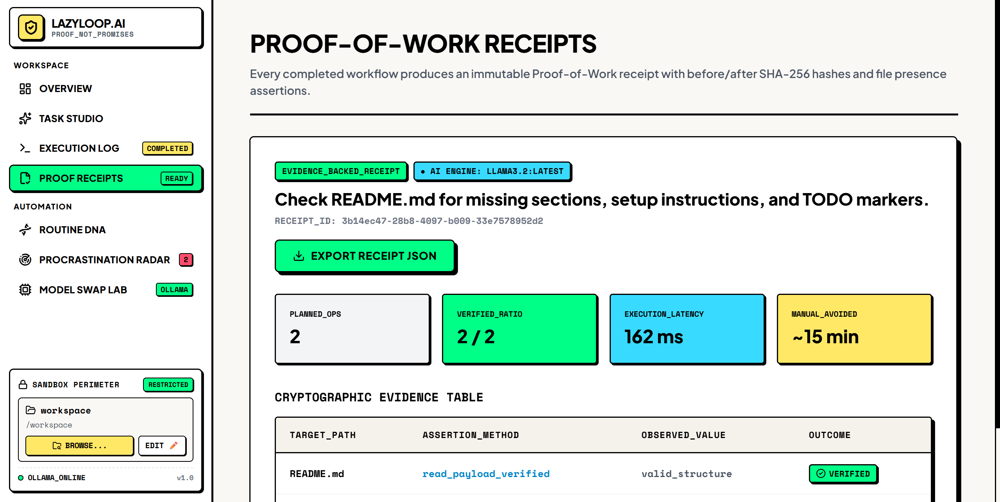
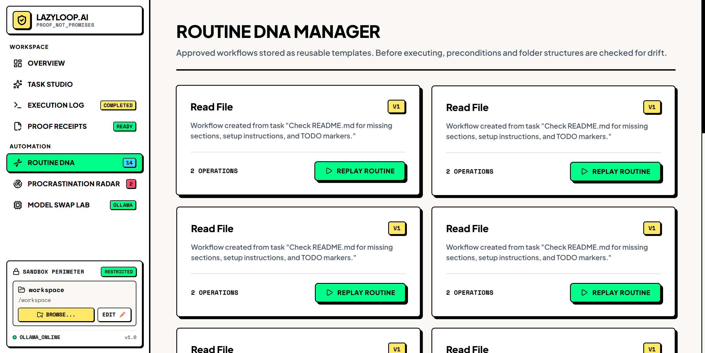
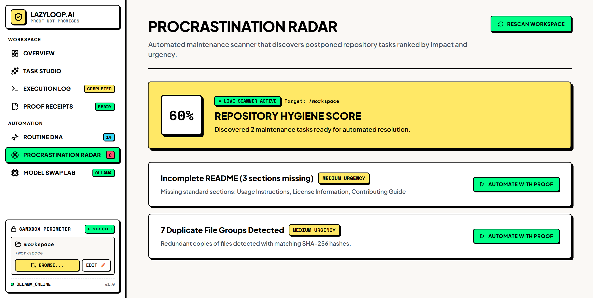
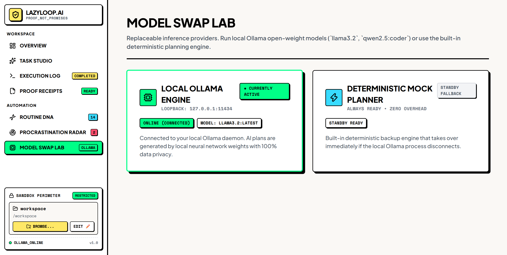
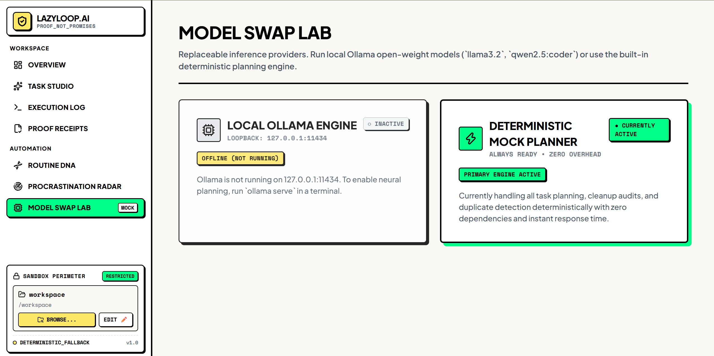
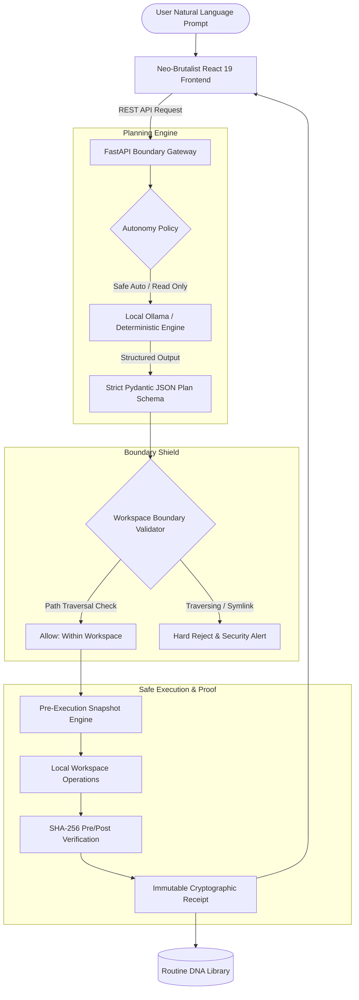

<div align="center">

# ⚡ LazyLoop AI

### **Do Less Busywork. Get Proof, Not Promises.**

*An open-source, local-first AI workflow assistant that eliminates repetitive digital chores, learns approved routines, and proves every modification with cryptographic receipts.*

[](./LICENSE)
[](https://www.python.org/)
[](https://fastapi.tiangolo.com/)
[](https://react.dev/)
[](https://www.typescriptlang.org/)
[](https://ollama.ai)
[](#-neo-brutalist-design-system)

---

[Key Highlights](#-key-highlights) •
[Visual Showcase](#-visual-showcase) •
[System Architecture](#-system-architecture) •
[Podman Desktop Setup](#-running-with-podman-desktop-recommended) •
[Bare-Metal Setup](#-alternative-local-bare-metal-setup) •
[Core Features](#-core-capabilities) •
[Security Model](#-security--safety-model) •
[Documentation](#-complete-technical-documentation)

---

</div>

## 🌟 The Problem with Modern AI Assistants

Traditional AI coding assistants ask for root access, hallucinate modifications, execute unverified shell commands, and send your proprietary codebase to remote clouds without consent. When they break things, you are left sifting through git diffs with zero audit trail.

**LazyLoop AI changes the paradigm:**
- 🛡️ **AI as Planner, Not Root**: The model strictly produces validated JSON execution plans. It possesses zero raw shell access.
- 🔒 **Physical Workspace Perimeter**: Hard-sandboxed to your chosen directory. Symlinks, absolute escape sequences, and `..` path traversals are hard-blocked at the OS boundary.
- 📜 **Cryptographic Proof Receipts**: Every altered file is hashed (SHA-256) before and after execution, producing immutable audit logs.
- ⏪ **1-Click Pre-Execution Rollbacks**: Every modified or deleted file is snapshot into `.lazyloop/backups/` before any byte is altered.
- 🧬 **Deterministic Routine DNA**: Approved cleanup operations turn into reusable recipes with automated drift and precondition validation.
- 💻 **100% Local Sovereignty**: Operates with local open-weight models via [Ollama](https://ollama.ai) (`llama3.2`, `qwen2.5-coder`) or an instant, offline deterministic fallback engine.

---

## 📸 Visual Showcase

Explore the Neo-Brutalist interface and workflow lifecycle of LazyLoop AI:

### 1. Command Station & Overview
*Central workspace telemetry, hygiene score, manual hours avoided, and rapid one-click chore triggers.*
<p align="center">
  
</p>

### 2. Task Studio (Natural Language Compiler)
*Bound your workspace root, choose autonomy policies (`Safe Auto`, `Review All`, `Dry Run`), and compile high-level prompts into sandboxed execution steps powered by live local Ollama.*
<p align="center">
  
</p>

### 3. Execution Log & Reversible Rollback Engine
*Inspect step-by-step progress, approve read/write mutations, execute 1-click bit-for-bit rollbacks, and extract verified workflows directly into Routine DNA templates.*
<p align="center">
  
</p>

### 4. Proof-of-Work Receipts & Cryptographic Verification
*Every completed task generates an immutable proof receipt with pre/post SHA-256 digests, assertion verifications, execution latency, and exportable JSON audit records.*
<p align="center">
  
</p>

### 5. Routine DNA Manager
*Turn approved workflows into repeatable templates. Automatic precondition drift detection guards against broken assumptions before re-running.*
<p align="center">
  
</p>

### 6. Procrastination Radar (Automated Maintenance Scanner)
*Background repository hygiene scanner detecting missing README sections, duplicate asset groups, and lingering TODOs ranked by urgency and impact.*
<p align="center">
  
</p>

### 7. Model Swap Lab (Dual Inference Providers)
*Hot-swap between local Ollama neural weights (`llama3.2:latest`) and a zero-dependency deterministic planning engine.*

| **Connected Local Ollama Engine** | **Standby Deterministic Planner** |
|:---:|:---:|
|  |  |
| *Active neural inference (`llama3.2:latest`)* | *Zero-overhead, instant deterministic fallback* |

---

## 🏛️ System Architecture

LazyLoop AI operates on a **Deterministic Execution Sandbox (DES)** architecture that separates model planning from file-system execution.



---

## 🚀 Quick Start

You can run LazyLoop AI using **Podman Desktop (Recommended)** with zero host runtime dependencies, or via **Bare-Metal Local Setup**.

---

### 🐳 Running with Podman Desktop (Recommended)

Run the complete LazyLoop AI stack (FastAPI Backend + React 19 Frontend + Local Ollama Container) in isolated containers. **No Ollama Desktop, Python, or Node.js installation is required on your host machine.**

#### Step 1: Install Podman Desktop
1. Download and install **Podman Desktop** from [podman-desktop.io](https://podman-desktop.io/).
2. On Windows, ensure the WSL2 backend is active.

#### Step 2: Allocate Machine Memory (Recommended: 4–6 GB)
Local neural weights (like `llama3.2`) require sufficient virtual machine memory:
```powershell
# Stop machine to adjust resources
podman machine stop

# Set memory to 6GB (6144 MB) and 4 CPUs
podman machine set --memory 6144 --cpus 4

# Restart the machine
podman machine start
```

#### Step 3: Launch Stack with Podman Compose
Clone the repository and spin up all three containers (`lazyloop-ollama`, `lazyloop-backend`, `lazyloop-frontend`):

```powershell
git clone https://github.com/arnab825/LazyLoop-Ai.git
cd "LazyLoop-Ai"

# Optional: Point to host workspace to sandbox (defaults to current dir)
$env:WORKSPACE_DIR = "D:\path\to\your\project"  # Windows
# export WORKSPACE_DIR="/path/to/your/project"   # Linux/macOS

# Spin up all containers
podman compose up -d --build
```

#### Step 4: Pull Models into Container Volume
Pull the open-weight model directly into the `lazyloop-ollama` container volume:
```bash
podman exec -it lazyloop-ollama ollama pull llama3.2:latest
```

#### Step 5: Access Dashboard
Open **[http://localhost:5173](http://localhost:5173)** in your browser.
- **Frontend Dashboard**: `http://localhost:5173`
- **FastAPI OpenAPI Docs**: `http://localhost:8000/docs`
- **Container Ollama Daemon**: `http://localhost:11434`

---

### 💻 Alternative: Local Bare-Metal Setup

If you prefer running without containers directly on your host machine:

#### Prerequisites
- **Python 3.12+**
- **Node.js 20+** and `npm`
- *(Optional for AI)* [Ollama](https://ollama.ai) installed with `ollama run llama3.2`

#### 1. Backend Setup
```bash
cd "LazyLoop Ai/backend"

# Windows (PowerShell):
python -m venv .venv
.venv\Scripts\Activate.ps1

# Linux / macOS:
python3 -m venv .venv
source .venv/bin/activate

# Install dependencies & launch FastAPI
pip install -r requirements.txt
python -m uvicorn app.main:app --host 127.0.0.1 --port 8000 --reload
```

#### 2. Frontend Setup
In a new terminal window:
```bash
cd "LazyLoop Ai/frontend"
npm install
npm run dev
```

> Open **[http://localhost:5173](http://localhost:5173)** in your browser.

> For deep-dive networking topology, GPU CDI passthrough, and Kubernetes-style Pods, see the [**Podman Deployment Guide**](./docs/DEPLOYMENT.md).

---

## 📦 Core Capabilities

| View / Tool | Description | Safety Guarantee |
| :--- | :--- | :--- |
| **Command Station (Overview)** | High-level workspace telemetry, hygiene score, manual time saved, and quick-trigger audits. | Read-only analysis. |
| **Task Studio** | Natural language instruction compiler with preset triggers (Smart Cleanup, Duplicate Finder, Docs Audit). | Interactive approval checkpoints before any mutation. |
| **Execution Log** | Live, step-by-step progress monitor displaying real-time shell & file operations with color-coded status badges. | Real-time pause & cancel controls. |
| **Proof Receipts** | Cryptographic verification hub showing pre/post SHA-256 hashes, timestamps, and one-click rollback buttons. | Tamper-evident immutable JSON records. |
| **Routine DNA** | Library of approved workflows compiled into reusable automation cards with drift detection. | Precondition validation prior to re-execution. |
| **Procrastination Radar** | Autonomous hygiene scanner detecting stale drafts, redundant assets, and undocumented exports. | Surfaces debt without altering files. |
| **Model Swap Lab** | Hot-swap between local Ollama instances (`llama3.2`, `qwen2.5-coder`, `mistral`) and deterministic mock mode. | Zero external API calls required. |

---

## 🔒 Security & Safety Model

LazyLoop AI is engineered under the assumption that **AI output is inherently untrusted**.

1. **Strict Path Sandboxing**:
   All operations are resolved against the absolute normalized path of the configured workspace. Path traversals (`../../../etc/passwd` or `C:\Windows\System32`) trigger immediate boundary exceptions:
   ```python
   # Enforced in backend/app/sandbox/boundary.py
   target = (workspace_root / path).resolve()
   if not str(target).startswith(str(workspace_root)):
       raise PermissionError("Access outside sandbox perimeter forbidden.")
   ```
2. **Pre-Execution Snapshots**:
   Before a file is edited or deleted, its complete original state is saved to `.lazyloop/backups/<task_id>/`.
3. **Atomic Rollback Protocol**:
   Every proof receipt includes a direct `UNDO` trigger. If an automation produces unexpected output, one click restores every modified file to its exact pre-task SHA-256 hash.
4. **Zero Remote Telemetry**:
   No code, prompts, hashes, or logs leave your local machine.

---

## 🎨 Neo-Brutalist Design System

LazyLoop AI utilizes a **Tactile Neo-Brutalist** design language built on Vanilla CSS variables:

| Token | Hex Value | Semantic Role |
| :--- | :--- | :--- |
| `--bg-canvas` | `#FAF8F5` | Warm, glare-free background surface |
| `--brutal-yellow` | `#FFE866` | Primary accents, interactive badges, brand glyph |
| `--brutal-lime` | `#00FF87` | Active state indicators, verified statuses, safe badges |
| `--brutal-cyan` | `#38DBFF` | Automation tags, routine counters, informational links |
| `--brutal-rose` | `#FF4D6D` | Dangerous actions, active menu indicators, radar warnings |
| `--border-thick` | `2px solid #000000` | Standard high-contrast card borders |
| `--shadow-brutal`| `4px 4px 0px #000000` | Hard, geometric drop shadows |

### Typography
- **Headings & Brand**: [Plus Jakarta Sans](https://fonts.google.com/specimen/Plus+Jakarta+Sans) (Weight 800/900)
- **Code, Hashes & Metrics**: [Space Mono](https://fonts.google.com/specimen/Space+Mono) & [JetBrains Mono](https://fonts.google.com/specimen/JetBrains+Mono)

---

## 📁 Repository Structure

```
LazyLoop-Ai/
├── backend/
│   ├── app/
│   │   ├── api/            # FastAPI route handlers (tasks, routines, radar, models)
│   │   ├── core/           # Config, settings, and logging
│   │   ├── models/         # Pydantic data schemas & state models
│   │   ├── planner/        # Ollama connector & deterministic planner fallback
│   │   ├── sandbox/        # Boundary defense, backup manager, & file operations
│   │   └── main.py         # Application entry point
│   ├── requirements.txt    # Python dependencies
│   └── tests/              # Backend safety & boundary test suite
├── frontend/
│   ├── src/
│   │   ├── components/
│   │   │   ├── views/      # Overview, Studio, Execution, Receipts, Routines, Radar, Models
│   │   │   └── Sidebar.tsx # Responsive Neo-Brutalist pinned navigation & sandbox card
│   │   ├── api.ts          # Strongly typed client API bindings
│   │   ├── App.tsx         # Main application layout & drawer state
│   │   ├── App.css         # Component styling tokens
│   │   └── index.css       # Core design tokens, layout grids, & mobile breakpoints
│   ├── package.json
│   └── vite.config.ts
├── docs/                   # Complete architecture, PRD, TRD, and security specifications
├── LICENSE                 # Apache 2.0 Open-Source License
└── README.md               # Primary project documentation
```

---

## 📚 Complete Technical Documentation

Comprehensive architectural blueprints and engineering specifications are located in [`docs/`](./docs/README.md):

| Document | Focus Area |
| :--- | :--- |
| **[Architecture Specification](./docs/ARCHITECTURE.md)** | Boundary validation loops, deterministic execution engine, and sequence flows. |
| **[Security & Threat Model](./docs/SECURITY.md)** | Sandboxing guarantees, path escape mitigations, and hash integrity protocols. |
| **[UI/UX Design Specification](./docs/UI_UX_SPECIFICATION.md)** | Neo-Brutalism tokens, responsive breakpoint matrix, and accessibility guidelines. |
| **[Product Requirements (PRD)](./docs/PRD.md)** | User personas, core user stories, and feature prioritization rubrics. |
| **[Technical Requirements (TRD)](./docs/TRD.md)** | API contracts, state storage schemas, and local model inference bounds. |
| **[Software Requirements (SRS)](./docs/SRS.md)** | Functional/non-functional requirements and system compliance criteria. |
| **[Database & Storage Design](./docs/DATABASE_DESIGN.md)** | Backup folder structures, routine serialization, and SQLite/JSON storage. |
| **[API Specification](./docs/API_SPECIFICATION.md)** | Complete OpenAPI / Swagger endpoints with request and response payloads. |
| **[Test Report](./docs/TEST_REPORT.md)** | Test coverage, boundary fuzzing results, and rollback verification benchmarks. |

---

## 🤝 Contributing

Contributions to LazyLoop AI are welcome! Whether you are adding a new routine preset, refining the Neo-Brutalist UI, or integrating additional local LLM providers:

1. Fork the Project.
2. Create your Feature Branch (`git checkout -b feature/NewHygieneCheck`).
3. Commit your Changes (`git commit -m "feat: add missing test scanner"`).
4. Push to the Branch (`git push origin feature/NewHygieneCheck`).
5. Open a Pull Request.

---

## 📄 License

Distributed under the **Apache 2.0 License**. See [`LICENSE`](./LICENSE) for full details.

---

<div align="center">
  <strong>Built with 💛 for developers who value their time, their privacy, and verifiable results.</strong>
</div>
