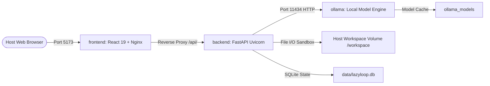

# 🚀 LazyLoop AI — Deployment & Containerization Guide

This guide details how to run LazyLoop AI using **Podman Desktop**, **Podman Compose**, or traditional local execution across Windows, Linux, and macOS.

---

## 📑 Table of Contents

1. [Architecture in Containers](#-architecture-in-containers)
2. [Running with Podman Desktop](#-running-with-podman-desktop)
   - [Method A: Podman Compose (Recommended)](#method-a-podman-compose-recommended)
   - [Method B: Native Podman Pod (Single-Pod Localhost)](#method-b-native-podman-pod-single-pod-localhost)
3. [Managing Ollama Models inside Podman](#-managing-ollama-models-inside-podman)
4. [Using Host Ollama with GPU Acceleration](#-using-host-ollama-with-gpu-acceleration)
5. [Sandboxed Workspace Volume Mounting](#-sandboxed-workspace-volume-mounting)
6. [Container Health Checks & Troubleshooting](#-container-health-checks--troubleshooting)

---

## 🏛️ Architecture in Containers

When deployed via Podman, LazyLoop AI runs in three isolated service containers:



### Port Mapping

| Service | Container Port | Host Port | Purpose |
|---|---|---|---|
| **frontend** | `5173` | `5173` | Neo-Brutalist React 19 Dashboard & Control Center |
| **backend** | `8000` | `8000` | FastAPI Boundary Gateway & Deterministic Execution Engine |
| **ollama** | `11434` | `11434` | Local LLM inference server (`llama3.2`, `qwen2.5-coder`) |

---

## 📦 Running with Podman Desktop

### Prerequisites

1. **Podman Desktop** installed ([podman-desktop.io](https://podman-desktop.io/)).
2. On Windows, initialize the Podman virtual machine (WSL2 backend):
   ```powershell
   podman machine init
   ```
3. **Allocate Sufficient RAM (Recommended: 4–6 GB)**:
   By default, Podman machines may start with only 2 GB of RAM, which is insufficient for loading open-weight neural models like `llama3.2` (2.0 GB). To prevent Out-Of-Memory (OOM) errors:
   ```powershell
   podman machine stop
   podman machine set --memory 6144 --cpus 4
   podman machine start
   ```
   > 💡 *Tip:* Check your active machine resource limits anytime via `podman machine info`.

> **Important**: You do **NOT** need to install Ollama Desktop on Windows. Ollama runs directly as an official Linux container (`lazyloop-ollama`) managed by Podman.

---

### Method A: Podman Compose (Recommended)

Podman Desktop natively integrates with compose.

#### 1. Configure Host Workspace
In the repository root, specify which host folder you want LazyLoop to manage:
```powershell
# Windows (PowerShell):
$env:WORKSPACE_DIR = "D:\hacktoberfest\LazyLoop Ai"

# Linux / macOS:
export WORKSPACE_DIR="/path/to/your/project"
```

#### 2. Start Services
From the repository root, run:
```bash
podman compose up -d --build
```
*(Or in Podman Desktop GUI: click **Compose** -> **Add Compose** -> select `compose.yaml` -> **Start**).*

#### 3. Verify Containers
In Podman Desktop:
- `lazyloop-frontend` (Running on `http://localhost:5173`)
- `lazyloop-backend` (Running on `http://localhost:8000`)
- `lazyloop-ollama` (Running on `http://localhost:11434`)

---

### Method B: Native Podman Pod (Single-Pod Localhost)

Podman supports Kubernetes-style **Pods**, where all containers share the same network namespace (`localhost`). This eliminates cross-container networking friction.

```bash
# 1. Create the unified pod
podman pod create --name lazyloop-pod -p 5173:5173 -p 8000:8000 -p 11434:11434

# 2. Run Ollama container inside the pod
podman run -d --pod lazyloop-pod \
  --name lazyloop-ollama \
  -v lazyloop_ollama_models:/root/.ollama \
  docker.io/ollama/ollama:latest

# 3. Build & Run Backend inside the pod
podman build -t lazyloop-backend -f backend/Containerfile backend/
podman run -d --pod lazyloop-pod \
  --name lazyloop-backend \
  -e LAZYLOOP_HOST=0.0.0.0 \
  -e OLLAMA_BASE_URL=http://127.0.0.1:11434 \
  -v ./data:/app/data:Z \
  -v ${WORKSPACE_DIR:-.}:/workspace:Z \
  lazyloop-backend

# 4. Build & Run Frontend inside the pod
podman build -t lazyloop-frontend -f frontend/Containerfile frontend/
podman run -d --pod lazyloop-pod \
  --name lazyloop-frontend \
  lazyloop-frontend
```

---

## 🧠 Managing Ollama Models inside Podman

Once the `lazyloop-ollama` container is running, pull your desired open-weight models:

```bash
# Pull the recommended planning model (Llama 3.2 3B)
podman exec -it lazyloop-ollama ollama pull llama3.2:latest

# Pull the coding specialist model (Qwen 2.5 Coder 7B)
podman exec -it lazyloop-ollama ollama pull qwen2.5-coder:latest

# Verify installed models
podman exec -it lazyloop-ollama ollama list
```

The models are stored in the persistent volume `lazyloop_ollama_models`, so you do not need to re-download them when restarting containers.

---

## ⚡ Using Host Ollama with GPU Acceleration

If you have native Ollama already installed on your host with NVIDIA CUDA, Apple Metal, or AMD ROCm GPU acceleration:

1. In `compose.yaml`, omit or stop the containerized `ollama` service.
2. In the `backend` environment variables, point to your host machine:
   ```yaml
   environment:
     - OLLAMA_BASE_URL=http://host.containers.internal:11434
   ```
3. Ensure your host Ollama is listening on all interfaces:
   - On Windows: set environment variable `OLLAMA_HOST=0.0.0.0` before launching Ollama.
   - On Linux: configure `systemctl edit ollama.service` with `Environment="OLLAMA_HOST=0.0.0.0"`.

---

## 🔒 Sandboxed Workspace Volume Mounting

LazyLoop AI operates strictly on files inside its sandboxed boundary.
- Inside the backend container, the target workspace is mapped to `/workspace`.
- In the Frontend **Settings / Studio**, enter `/workspace` as your active Workspace Path.
- Path traversal outside `/workspace` is automatically blocked by `WorkspaceValidator`.

---

## 🛠️ Container Health Checks & Troubleshooting

### Check Backend Health
```bash
curl http://localhost:8000/api/v1/health
# Response: {"status":"healthy","database":"connected","workspace_configured":true}
```

### Check Available Models in Backend
```bash
curl http://localhost:8000/api/v1/models
# Response: {"available_models":["llama3.2:latest"],"connected_provider":"ollama"}
```

### Common Issues
1. **SELinux Permissions (`:Z` flag)**: If running rootless on Fedora / RHEL, keep the `:Z` flag on volume mounts to relabel host paths for container read/write access.
2. **Deterministic Mock Mode**: If Ollama is downloading or offline, LazyLoop AI automatically falls back to its deterministic planning engine (`FALLBACK_TO_MOCK=true`), ensuring full functionality even without an active GPU.
3. **Nginx Dynamic DNS Resolution**: If the backend container restarts and receives a new container IP, the frontend Nginx is configured with `resolver ${NGINX_LOCAL_RESOLVERS} valid=5s;` to re-resolve the upstream within 5 seconds without throwing HTTP 502 Bad Gateway.
4. **Podman Socket Disconnect (Windows)**: If Podman Desktop loses connection to the WSL machine, wake it up via `podman machine stop` followed by `podman machine start`.

---

## 📸 Deployment Visual Verification

| **1. Overview & Command Station** | **2. Task Studio (Live Neural Engine)** |
|:---:|:---:|
|  |  |
| **3. Step-by-Step Execution Log** | **4. Cryptographic Proof Receipt** |
|  |  |
| **5. Routine DNA Manager** | **6. Procrastination Radar** |
|  |  |
| **7. Model Swap Lab (Ollama Online)** | **8. Model Swap Lab (Mock Fallback)** |
|  |  |

