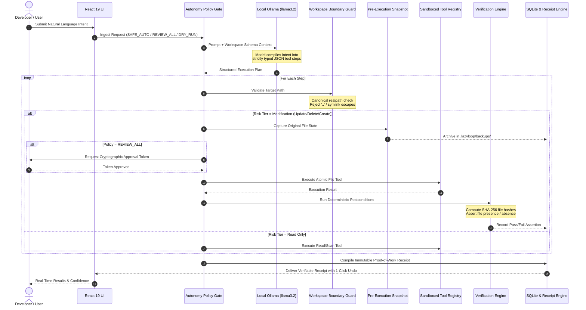

*This is a submission for the [Hacktoberfest Open-Source AI Challenge Week 3: Slow and Steady](https://dev.to/challenges/hacktoberfest-week3-2026-10-19)*

---

## What I Built

Developers and creators lose hundreds of hours each year to mundane digital housekeeping:
- Hunting down duplicate media and assets bloating repositories.
- Auditing missing documentation and inconsistent `README.md` sections.
- Tracking down forgotten `TODO`, `FIXME`, and `HACK` markers.
- Pruning temporary scratch files, build artifacts, and stale test dumps.

When developers attempt to automate these chores with standard AI coding agents, they quickly run into the **"Trust Paradox"**:
- **Promises Instead of Proof**: The LLM outputs "Done! I cleaned your repository," but there is no verifiable evidence of what was actually changed.
- **Root Shell Danger**: Most agents demand unrestricted terminal or bash access (`rm`, `sh`, `powershell`), exposing the system to accidental disk wipes or prompt injection attacks.
- **Destructive & Irreversible**: When an AI hallucinates or mangles source code, there is no built-in undo mechanism.
- **Data Exfiltration**: Proprietary code and private assets are continuously sent over the wire to remote, closed-source cloud APIs.

### Meet LazyLoop AI: Proof, Not Promises

**LazyLoop AI** is an open-source, local-first AI workflow assistant engineered around the principle of **"Slow and Steady"** safety. It automates repetitive workspace chores without giving the AI root access, exfiltrating code to the cloud, or making unverified modifications.

```
┌────────────────────────────────────────────────────────────────────────┐
│                        LAZYLOOP AI CORE PROMISE                         │
│                                                                        │
│   "The AI is the Planner, never the Executioner.                       │
│    Every file change is backed up, bounded by OS sandboxes,            │
│    and proven with cryptographic SHA-256 receipts."                    │
└────────────────────────────────────────────────────────────────────────┘
```

### Key Pillars
1. **AI as Planner, Not Root**: The AI (powered locally by open-weight models like `llama3.2` via Ollama) only outputs strict, Pydantic-validated JSON tool plans. Raw shell commands (`exec`, `bash`, `cmd`, `sh`) are physically omitted from the engine.
2. **Physical Workspace Boundary (`WorkspaceValidator`)**: File access is strictly contained to an authorized folder. Path traversals (`../../etc/passwd`), null-byte injections, drive hopping, and symlink escapes are hard-blocked at the OS boundary.
3. **Pre-Execution Snapshots & 1-Click Rollback**: Before any file is modified or deleted, an automated pre-execution snapshot is archived in `.lazyloop/backups/<task_id>/`. If an automation produces unexpected results, one click restores every file bit-for-bit.
4. **Cryptographic Proof Receipts**: LazyLoop verifies every action deterministically using pre/post SHA-256 hashes and file presence assertions. You receive an immutable Proof-of-Work receipt with timing and byte hashes.
5. **Routine DNA**: Approved workflows can be saved as reusable automation routines with automatic precondition drift detection before re-execution.
6. **Procrastination Radar**: An automated workspace scanner that inspects thousands of files in **under 200 ms** to identify forgotten maintenance debts ranked by urgency.

> **Who gets to be lazier?** Developers, open-source maintainers, students, and teams who want automated workspace maintenance with complete data sovereignty and zero fear of losing work.

---

## Demo


### Visual Walkthrough

| **1. Command Station Overview** | **2. Task Studio (Live Neural Engine)** |
|:---:|:---:|
|  |  |
| *Real-time workspace health, recent runs, and quick actions.* | *Natural language planning, model selector, and safety policies.* |
| **3. Step-by-Step Execution Log** | **4. Cryptographic Proof Receipt** |
|  |  |
| *Real-time progress badges, risk-tier tagging, and step inspector.* | *Pre/post SHA-256 hashes, latency metrics, and 1-click undo.* |
| **5. Routine DNA Manager** | **6. Procrastination Radar** |
|  |  |
| *Reusable automation templates with precondition drift guards.* | *Sub-200ms hygiene scanner ranking maintenance debts.* |
| **7. Model Swap Lab (Ollama Online)** | **8. Model Swap Lab (Deterministic Mock Fallback)** |
|  |  |
| *Live local inference running `llama3.2:latest` on Podman.* | *Zero-dependency mock fallback ensuring 100% uptime.* |

---

## Code

The complete source code, architectural specifications, and deployment manifests are available on GitHub:



### Tech Stack at a Glance
- **Frontend**: React 19, TypeScript, Vite, Vanilla CSS (Warm Neo-Brutalist Design System)
- **Backend API**: Python 3.12, FastAPI, SQLite (aiosqlite), Pydantic v2, Uvicorn
- **Local AI Provider**: Ollama Container (`llama3.2:latest`, `qwen2.5-coder`) with Deterministic Mock Fallback
- **Containerization**: Podman Desktop & Docker Compose, Multi-stage Nginx with Dynamic DNS Upstream Resolution
- **License**: Apache 2.0 Open-Source License

---

## Deep Dive: How the Architecture Flows

Traditional AI agents connect an LLM directly to a bash shell and pray for the best. LazyLoop AI introduces a **Deterministic Execution Sandbox (DES)** pipeline that separates planning from execution through eight distinct safety checkpoints.



### The 8-Layer Safety Pipeline Explained

#### 1. Ingestion & Autonomy Policy Gate
When a user submits a prompt, they define the automation guardrail level:
- **`SAFE_AUTO`**: Read-only reconnaissance steps (`list_directory`, `find_duplicate_files`, `check_doc_gaps`) execute automatically; state-modifying actions pause for explicit approval.
- **`REVIEW_ALL`**: Strict zero-trust mode where every single planned action requires manual developer sign-off.
- **`DRY_RUN`**: Full non-destructive simulation. Analyzes and plans operations without touching a single file on disk.

#### 2. AI as Planner, Never Executioner
The user prompt is forwarded to a local Ollama container (`lazyloop-ollama`) running `llama3.2:latest`. 
- The model is instructed to output **only structured JSON conforming to Pydantic schemas**.
- Available tools are restricted to a closed whitelist: `list_directory`, `read_file`, `find_duplicate_files`, `check_doc_gaps`, `create_file`, `update_file`, `delete_file`, and `move_file`.
- Raw shell execution (`exec`, `bash`, `cmd`, `sh`) is strictly omitted. Prompt injections cannot trick the model into executing OS commands because the backend has no shell runner.

#### 3. Zero-Downtime Fallback Planner
If Ollama is offline, updating, or currently pulling model weights, LazyLoop AI automatically falls back to its built-in **Deterministic Mock Planner**. The user never encounters an application crash or broken workflow.

#### 4. Physical Sandbox Perimeter (`WorkspaceValidator`)
Before any tool touches the filesystem, `WorkspaceValidator` computes canonical real paths:
```python
# Realpath canonicalization & directory traversal rejection
canonical_root = os.path.realpath(os.path.abspath(workspace_root))
candidate_path = os.path.abspath(os.path.join(canonical_root, clean_subpath))
resolved_path = os.path.realpath(candidate_path)

if os.path.commonpath([canonical_root, resolved_path]) != canonical_root:
    raise SecurityBoundaryException(f"Path '{target_subpath}' escapes workspace!")
```
Any attempt to jump out to parent directories (`../../`), invoke Windows drive letters (`C:\Windows`), or traverse symlinks is halted with a security boundary exception.

#### 5. Pre-Execution Snapshot Engine (`BackupService`)
Before any modification (`update_file`, `delete_file`, `create_file`), LazyLoop archives the existing file into `.lazyloop/backups/<task_id>/`:
- The exact original content is preserved alongside its pre-change SHA-256 hash.
- If a file is newly created, an empty marker is logged so that undo will safely delete it.
- **Result:** You get a 100% deterministic, 1-click **Undo Rollback** button for every task.

#### 6. Sandboxed Tool Execution
The permitted operation executes strictly within the validated workspace root. Actions produce structured outputs detailing modified paths, byte counts, and execution timestamps.

#### 7. Cryptographic Verification Engine (`VerificationEngine`)
Rather than asking the LLM "Did you succeed?", LazyLoop computes ground-truth postconditions:
- **File Creations & Updates**: Computes the actual SHA-256 hash of the modified file on disk and verifies that `expected_hash == actual_hash`.
- **File Deletions**: Verifies physical absence from the filesystem.
- **Duplicate Scans**: Asserts duplicate hash groups against byte equality.

#### 8. Immutable Proof-of-Work Receipts & Routine DNA
The results are compiled into a persistent JSON receipt stored in SQLite containing:
- Pre-execution and post-execution SHA-256 hashes.
- Wall-clock latency (ms) and operations count.
- **Calculated manual minutes avoided**.
- One-click **"Save as Routine DNA"** to turn verified workflows into reusable automation templates with automatic precondition drift checking.

---

## Which Specific Problems Does LazyLoop Solve?

| Traditional AI Assistants | The Real-World Risk | The LazyLoop AI Solution |
|:---|:---|:---|
| **"Trust Me" Promises** | LLMs claim code was formatted or files were cleaned, but hallucinate or make silent mistakes. | **Cryptographic SHA-256 Receipts**: Every operation is physically checked against the filesystem. Pass/Fail is asserted mathematically. |
| **Unbounded Root Access** | Agents ask for terminal access (`bash`, `cmd`), opening the door to `rm -rf /` or prompt injection exploits. | **Physical OS Sandbox**: Zero shell tools exist. Operations are restricted to white-listed file operations within `/workspace`. |
| **No Undo Mechanism** | If an AI modifies files destructively, your code is corrupted or lost forever unless you had a clean git stash. | **Pre-Execution Snapshots**: Original files are backed up automatically. One click restores every file bit-for-bit. |
| **Cloud Data Exfiltration** | Proprietary repositories, student homework, and business secrets are sent to remote corporate servers. | **100% Local Inference**: Powered by local open-weight models (`llama3.2`) running inside isolated Podman containers. |
| **Housekeeping Procrastination** | Maintenance chores (doc gaps, duplicate assets, forgotten TODOs) are continuously delayed because they are boring. | **Procrastination Radar**: Sub-200ms background scanner identifies and prioritizes debts so you can fix them in seconds. |

---

## How Users Benefit: The Real-World Impact

### 1. Total Peace of Mind (Zero "AI Anxiety")
With traditional agents, developers hold their breath before hitting "Execute," dreading that the assistant will delete files or rewrite unwanted sections. LazyLoop AI removes that anxiety:
- Every change has a pre-execution snapshot.
- Every change has an immediate, 1-click rollback.
- Every change is verified with cryptographic hashes.

### 2. Complete Data Sovereignty & Zero Cloud Costs
- **No Token Metering**: Run hundreds of repository audits without worrying about API bills, surge pricing, or rate limits.
- **Offline Capable**: Works entirely on an airplane, in secure air-gapped corporate environments, or during internet outages.
- **Private Code Stays Private**: Your code, notes, and documents never leave your local machine.

### 3. Measurable Time Savings (The Lazy Payoff)
- **20-30 minutes of manual chores → 2 seconds**: What used to take a developer 20 minutes of hunting down duplicate media files, auditing `README.md` completeness, or cleaning temp files is resolved in seconds.
- **Verifiable Receipts for Teams & Open-Source**: Maintainers can attach LazyLoop proof receipts to pull requests, demonstrating that repository hygiene checks were run and cryptographically verified.

### 4. Reusable Automation Without Scripting (Routine DNA)
Instead of writing and maintaining brittle bash or python cleanup scripts, developers run a natural-language task once, verify the proof receipt, and save it as a **Routine**. Future runs automatically verify preconditions before re-executing.

---

## Why Open Innovation Matters

Open innovation is not just an ideological preference for LazyLoop AI—it is the foundation of its safety architecture:

1. **Auditability Over Secrecy**: Closed AI APIs are black boxes. Their prompts change, their models drift, and their safety policies are opaque. Open-source models like `llama3.2` and open-source harnesses allow developers to audit every byte that moves between the model and the operating system.
2. **True Reproducibility**: When a developer creates a Routine DNA template using an open-weight model running locally, they can be confident that the routine will produce consistent results tomorrow, next month, and next year—unaffected by remote model deprecations.
3. **Democratizing Developer Productivity**: High-quality workflow automation should not be gated behind expensive monthly subscriptions or cloud API quotas. Open-source AI turns intelligent workspace automation into a zero-marginal-cost public good.

---

## Running LazyLoop AI Locally (Podman Desktop)

LazyLoop AI is designed for seamless, single-command setup using **Podman Desktop** or **Docker Compose**:

### 1. Clone the Repository
```bash
git clone https://github.com/arnab825/LazyLoop-Ai.git
cd LazyLoop-Ai
```

### 2. Launch with Podman Compose
```bash
podman-compose up -d --build
```

### 3. Pull the Local Model
```bash
podman exec -it lazyloop-ollama ollama run llama3.2:latest
```

### 4. Open the Command Station
Navigate to **`http://localhost:3000`** in your browser. All services (Frontend, Backend, and Ollama) are connected and ready to automate!

> *Tip: For Podman on Windows or macOS, allocate 4–6 GB of memory to the Podman machine for optimal local LLM performance.*

---

## My Agent Session

This project was built with the assistance of Antigravity AI, adhering to clean architecture, test-driven reliability, and local containerization best practices.

<!-- DEVRELAY_SESSION_TAG: If embedding an interactive DevRelay transcript, insert the liquid tag below: -->
<!--  -->

---

## Prize Categories

- **Primary Track:** Hacktoberfest Open-Source AI Challenge Week 3: Slow and Steady
- **Focus Area:** Open Innovation, Local-First AI, Developer Productivity, and Verifiable AI Safety

---

## Conclusion

The future of AI assistance shouldn't be about giving remote LLMs raw terminal power and hoping they don't break things. It should be about **careful planning, strict sandboxes, pre-execution backups, and cryptographic verification**.

LazyLoop AI lets you do less busywork, embrace being a little lazier, and enjoy complete confidence in your codebase.

**Do less. Verify more. Get proof, not promises.**

---

*Built with 💛 using local open-weight AI, Podman Desktop, React 19, FastAPI, and verifiable cryptographic proof.*
